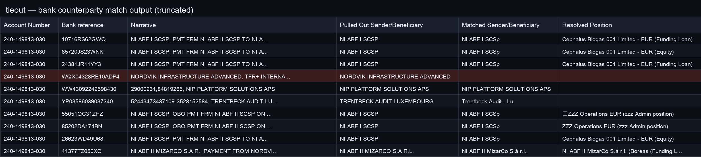

# tieout

**Every cell tied to its source.**

Human-reviewed spreadsheet reconciliation for finance close. The new governed-memory
workflow turns an explicit correction into a scoped, replay-tested rule for future
suggestions. Keep the workbook process; stop solving the same exception from scratch.

**CoreWeave Hacks:** W&B/Weave experiments plus a local correction-memory prototype.
The original reconciliation engine is disclosed prior work from **Syndicate by Maximor** ·
Track 2: Autonomous Office of the CFO · [Devpost](https://syndicate-by-maximor.devpost.com/).

The new workflow is local and human-approved, not autonomous ledger posting or a
production multi-tenant service. See [the product, demo, and pilot plan](docs/COREWEAVE.md).

---

## close-keeper — Seapoint MCP + Claude (FinOps Hackathon 2026)

**FinOps Hackathon · Seapoint × 13books Capital × Claude · October 2026.**
close-keeper connects to Seapoint's MCP — reading live transactions, invoices and
burn/cash/runway — runs the tie-out in the background, and **only surfaces the
judgment queue: the fraction it won't code without a human, each with its evidence.**

Built with Claude (Anthropic API) and the
[Strands Agents SDK](https://github.com/strands-agents/sdk-python) on top of
tieout's verified machinery. Seapoint's mutating tools are held behind one governed,
evidenced, logged write path (see [close_keeper/README.md](close_keeper/README.md)).

**Outcome: did not place.** The judges' reason was that the entry didn't show a workflow people
already do and how the agent improves on it — fair, and now written out under
[The workflow this sits inside](close_keeper/README.md#the-workflow-this-sits-inside). The
technical claims are unchanged and itemised under
[Verified](close_keeper/README.md#verified).

Try it without an account (local close package, no keys, no Seapoint):

[](https://molab.marimo.io/github/udirobert/tieout/blob/main/close_keeper/demo_app.py)
[](https://udirobert.github.io/tieout/)

```bash
uv sync --directory research --extra agent
research/.venv/bin/python -m close_keeper --no-seapoint \
  "Tie out the close package (all tasks), then tell me which cells need my decision and why."
```

For live Seapoint: connect the MCP through Claude (the sandbox admits only Claude's
connector) and drive the beats in that session — see [close_keeper/README.md](close_keeper/README.md).

---

## Docs

| Read | Purpose |
|------|---------|
| [udirobert.github.io/tieout](https://udirobert.github.io/tieout/) | Public frontend: the workflow, the counted numbers, the film |
| [videos/close-keeper-finops/](videos/close-keeper-finops/) | The 2:00 entry film, its frame-by-frame source, and `BRIEF.md` |
| [docs/NEO4J.md](docs/NEO4J.md) | Neo4j Aura: cell-lineage graph + lexical GraphRAG |
| [docs/COREWEAVE.md](docs/COREWEAVE.md) | CoreWeave Hacks: the self-improvement loop |
| [docs/SYNDICATE.md](docs/SYNDICATE.md) | Submission summary |
| [docs/demo.md](docs/demo.md) | Demo video script |
| [docs/submit.md](docs/submit.md) | Checklist + Devpost + AO |
| [docs/HACKATHONS.md](docs/HACKATHONS.md) | close-keeper's next entries: which events admit an existing project, and what each needs |

---

## Governed close-memory demo (new)

```bash
uv sync --directory research
DEMO_DIR=$(mktemp -d /tmp/tieout-memory-demo.XXXXXX)
uv run --directory research python ../demo/memory_scenario.py --out-dir "$DEMO_DIR"
uv run --directory research marimo run ../demo/console.py   # Memory tab; picker finds $DEMO_DIR
```

Use the generated database/workbooks in the workspace. The script shows a
synthetic correction, replay gate, explicit activation, second-cycle suggestions,
and revocation. It ends revoked; `evidence.json` preserves every stage and
`cycle2-reviewed.xlsx` preserves the suggestions exported while active. No API
key is needed. This is a functional demonstration, not a measured customer ROI.

## Original reconciliation quick start

```bash
python3 demo/build_fixtures.py
./demo/simulate_demo.sh close-tieout-bank-cp
cd research && uv run python ../harness/exceptions.py review /tmp/syndicate-demo/exceptions.json
```

Live: set `TINKER_API_KEY` from `.env`, then `./demo/run_demo.sh close-tieout-bank-cp`

## Self-improvement loop (CoreWeave Hacks)

Set `WANDB_API_KEY` in `.env` — enables W&B Inference + Weave tracing/evals.

```bash
# pipeline on W&B Inference, traced:
cd research && uv run python ../harness/pipeline.py \
  --dataset-dir ../demo/close-tieout --out-dir /tmp/tieout-wandb \
  --model wandb:meta-llama/Llama-3.3-70B-Instruct

# the loop: eval -> cluster failures -> mutate skills -> re-score -> keep/revert
uv run python loop.py --dataset-dir data/spreadsheetbench_verified_400 \
  --sample 20 --iters 3 --out-dir /tmp/tieout-loop

# console (marimo): Run tab = accuracy curve + exception review; Graph tab = lineage
uv run marimo run ../demo/console.py
```

## Qwen3-8B on SpreadsheetBench-400 (molab, free RTX Pro 6000)

Two eval passes against `Qwen/Qwen3-8B` via vLLM 0.29 — no API keys, served
locally on molab's free GPU. Headline: **thinking-on outperforms thinking-off
by ~5 points on sheet-level pass rate (17.60% vs 12.80%) and ~18 points on
cell-level pass rate (34.55% vs 16.36%)**, at 4× the wall-clock cost. Cell
accuracy is essentially flat (~36%). Both runs, predictions, results, and a
side-by-side comparison live in `research/data/eval/qwen3-8b-molab/`.

## Knowledge graph (Neo4j)

Set `NEO4J_URI`/`NEO4J_USER`/`NEO4J_PASSWORD` in `.env` (Aura) — every answer cell becomes a
stable `(:Cell)` node tied to its source cells, the counterparty it matched, and the exception it
raised, and the agent reads the seeded counterparty master (510 identities, against the 71-row copy
in the workbook) back to ground column K. Without creds it no-ops: identical `exceptions.json`,
prompts, and scores. For lineage the graph is a derived index, not the authority — `rebuild_graph.py`
reconstructs it from a run's artifacts, so a paused or deleted free Aura instance costs nothing.
Details, including the measured read-path A/B and the fixture's answer-key leak, in
[docs/NEO4J.md](docs/NEO4J.md).

```bash
# seed the counterparty master, then write lineage offline (no API key)
cd research && uv run --extra graph python ../demo/seed_graph.py
TIEOUT_RUN_ID=demo ./demo/simulate_demo.sh close-tieout-bank-cp

# read candidates back (the GraphRAG retrieval), or run live with the read on
cd research && uv run --extra graph python ../harness/graph.py query "NIP LIT"
TIEOUT_GRAPHRAG=1 ./demo/run_demo.sh close-tieout-bank-cp

# recover the graph from artifacts after an Aura pause/delete
cd research && uv run --extra graph python ../demo/rebuild_graph.py /tmp/syndicate-demo
```

## Example output

Bank counterparty match: `Matched Sender/Beneficiary` filled where the lookup resolves; empty cells are routed to `exceptions.json` with source-row evidence.



---

## Layout

```
close_keeper/  Strands agent for the close (Agents for Humans)
demo/          CFO fixtures + scripts + marimo console
docs/          SYNDICATE.md, demo.md, submit.md
harness/       agent pipeline
research/      dependencies (uv sync)
```

Built with AO · Python · openpyxl · Tinker (Qwen3.8-27B)
