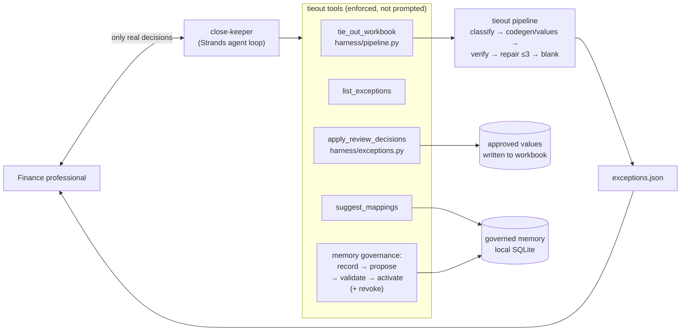

# close-keeper — a Strands agent for the financial close

[](https://molab.marimo.io/github/udirobert/tieout/blob/main/close_keeper/demo_app.py)

**FinOps Hackathon · Seapoint × 13books Capital × Claude · October 2026**

The 12-person startup with no finance hire — paying a fractional CFO by the
hour — does the close at 11pm. Seapoint already resolves the clean majority:
burn, cash, runway, and most invoice-to-bank matching. What's left is the
**judgment queue** — the handful of transactions where a human actually has to
decide. close-keeper connects to **Seapoint's MCP**, reads burn/cash/runway and
the live transactions, and **surfaces only that queue — with the evidence
attached.**

Everyone in AI accounting sells you *accuracy* — a number you have to trust.
close-keeper sells you the **2.2% it refuses to touch**: the cells it won't fill,
with the source rows that say why, and a ledger write-path where every change
carries its own audit record. That's not a model benchmark — it's an audit
trail, and it's the difference between an agent a fund will let near a ledger and
one it won't.

Built with Claude (Anthropic API) and the
[Strands Agents SDK](https://github.com/strands-agents/sdk-python)
on top of [tieout](../)'s verified machinery. Every capability is a tool;
the governance rules below are enforced by the tools, not by the prompt.

> **Also the Professional Agents track submission** for a prior Agents for Humans hackathon.
> The Seapoint MCP integration is a live addition for the October 2026 FinOps Hackathon.

## The working agreement

- **Blank is an answer.** Cells the pipeline can't verify route to the exception
  queue. The agent never fills a cell on a hunch.
- **One write path.** Approved values are written only through
  `apply_review_decisions` → `harness/exceptions.apply_decisions`, which persists
  the decision before touching any workbook. There is no other way to write.
- **Memory learns through governance.** A correction becomes a rule only via
  `record_correction → propose_rule → validate_rule → activate_rule`. The replay
  gate demands positive, hard-negative, scope-boundary and conflict coverage with
  zero regressions; the tools refuse ineligible activations and double revokes.
- **Attention is the scarce resource.** What reaches the human is a short list:
  cell, why flagged, proposed value, evidence rows.

## Architecture



The agent loop's model is pluggable:
- **Claude** via Anthropic API (`ANTHROPIC_API_KEY` — recommended for the hackathon)
- W&B Serverless Inference (default when `WANDB_API_KEY` is present)
- Any OpenAI-compatible endpoint (`CLOSE_KEEPER_BASE_URL` / `CLOSE_KEEPER_API_KEY` / `CLOSE_KEEPER_MODEL`)
- Amazon Bedrock via Strands' default (`--bedrock`)

The tie-out pipeline's own model is configured independently in `harness/pipeline.py`.

## Seapoint connection (remote MCP, OAuth)

Seapoint exposes its data through a **remote MCP server over streamable HTTP with
OAuth** at `https://mcp.seapoint.dev/mcp` — there is no static Seapoint API token.

**For the hackathon sandbox, connect through Claude** (Claude Code or Desktop).
Its Auth0 tenant **disables dynamic client registration and issues no client_id**,
so only a client Seapoint pre-registered — the Claude connector — can sign in. You
register once and Claude manages the OAuth tokens in its own store; nothing goes in
`.env`, and Claude itself becomes the authenticated harness:

```bash
claude mcp add --transport http seapoint-staging https://mcp.seapoint.dev/mcp
# then run /mcp, pick seapoint-staging, and authenticate in the browser
```

**The standalone agent** (`python -m close_keeper`) reaches a Seapoint server via
`close_keeper/seapoint.py` when it can authenticate itself — i.e. against a
deployment that issues a token or **enables** DCR (not the sandbox). It's adaptable
by design:

- **Discovers tools at runtime** — it lists whatever the connected workspace
  exposes (`query_transactions`, `query_accounts`, `query_invoices`,
  `query_treasury_returns`, …), namespaced `seapoint_*`, instead of assuming
  fixed endpoints. New Seapoint tools appear with no code change.
- **Points anywhere** — `SEAPOINT_MCP_URL` selects staging / prod / a local mock
  (default: prod).
- **Any auth the server offers** (first match wins): `SEAPOINT_MCP_TOKEN` (static
  bearer), `SEAPOINT_MCP_CLIENT_ID`/`_CLIENT_SECRET` (OAuth client_credentials),
  or `SEAPOINT_MCP_OAUTH=1` for interactive OAuth (dynamic registration + PKCE,
  browser sign-in once, token cached and refreshed — `close_keeper/seapoint_oauth.py`).
  **Note:** interactive OAuth needs the server to allow DCR; the hackathon sandbox
  does not, so use the Claude connector above for it.
- **Degrades cleanly** — unconfigured, disabled (`SEAPOINT_MCP_ENABLED=0` or
  `--no-seapoint`), or unreachable, the agent still runs on the local close
  package and says so; it never pretends to have read live data.

All of these are optional and documented in `.env.example`.

### Governed write-back — the single path to the ledger

When live, Seapoint's **read** tools (`query_*`, `get_current_user`) are exposed to
the agent, but its **mutating** tools (`set_transaction_category` / `_coding` /
`_vendor`, `update_vendor`, `approve_reconciliation`) are **held back and never
handed to the model.** The only way the agent can change ledger data is through the
governed wrappers in `close_keeper/seapoint_writes.py`, each of which:

- **previews first** (`confirm=false` shows *transaction → before → after*; nothing changes),
- **refuses a confirmed write with no `evidence`** (why the change is correct), and
- **returns Seapoint's own audit record** — the `previous_*` value and the `change_id`
  into Seapoint's change log.

So it is *structurally* impossible for the agent to mutate the ledger except through a
confirmed, evidenced, logged step. The `set_coding → awaiting_approval →
approve_reconciliation` state machine maps exactly onto close-keeper's
exception → decision → apply flow. "Blank is an answer" is enforced by the write
path, not the prompt.

## Run it

```bash
uv sync --directory research --extra agent   # adds strands-agents

# Sandbox (hackathon): connect Seapoint through Claude — see "Seapoint connection"
# above — then drive the live beats inside that Claude session, where close-keeper's
# governed tools layer on top. The sandbox blocks a standalone app from signing in.

# Standalone live run against a token- or DCR-enabled Seapoint deployment:
ANTHROPIC_API_KEY=<key> SEAPOINT_MCP_TOKEN=<token> \
  research/.venv/bin/python -m close_keeper \
  "What did we spend last month by category? Then code the needs-review queue and tell me what needs my decision."

# with local demo data (no keys, no Seapoint needed):
research/.venv/bin/python -m close_keeper --no-seapoint \
  "Tie out the close package (all tasks), then tell me which cells need my decision and why."
```

The sanity check from the brief — *"What did we spend last month, by category?"* —
confirms a live connection in ten seconds before the reconciliation loop runs.

**Live demo (no keys needed):** `demo_app.py` — a guided molab walk through the
exception queue, the recorded write path, and the governance gate, including the
refusals. **Deploy:** [DEPLOY.md](DEPLOY.md) puts the agent on Bedrock AgentCore
Runtime; [policies/](policies/) restates the governance as Cedar at the Gateway
boundary, so a compromised loop still can't write a decision or activate a rule.

Then decide, and the agent writes through the governed path:

```
"Approve Movements Rec!F2 and F3, reject F4."
```

Keys live in the repo `.env` (gitignored): `WANDB_API_KEY` or
`CLOSE_KEEPER_API_KEY` for the agent loop, `TINKER_API_KEY` for the pipeline's
default model, and the optional `SEAPOINT_MCP_*` for the live connection. No key
is ever echoed to the model.

## Tools

| tool | wraps | writes? |
|---|---|---|
| `tie_out_workbook` | `harness/pipeline.py` | run artifacts in `--out-dir` |
| `list_exceptions` | `exceptions.json` | no |
| `apply_review_decisions` | `harness/exceptions.apply_decisions` | yes — recorded decisions only |
| `preview_workbook` | `research/sb.serialize_workbook` | no |
| `suggest_mappings` | `memory_store.suggest` | no |
| `list_memory_rules` | `memory_store.rules` | no |
| `record_correction` / `propose_rule` / `validate_rule` / `activate_rule` / `revoke_rule` | `harness/memory_store.py` | yes — governed SQLite |

## Verified

End-to-end against `demo/close-tieout` (3 tasks, Tinker Qwen3.8-27B pipeline,
Llama-3.3-70B agent loop on W&B Inference): the agent tied out all tasks, surfaced
24 pending exceptions with evidence, applied a mixed approve/reject decision set
through the recorded write path (approved kept, rejected reverted to init), and
was refused by the governance gate on an ineligible activation and a double
revoke. See `docs/COREWEAVE.md` for the underlying harness verification record.
