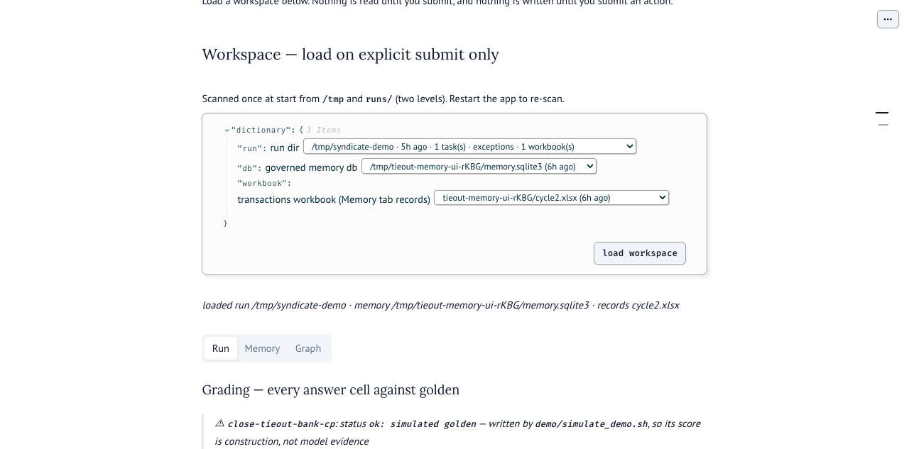
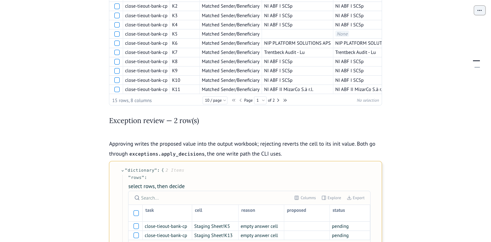
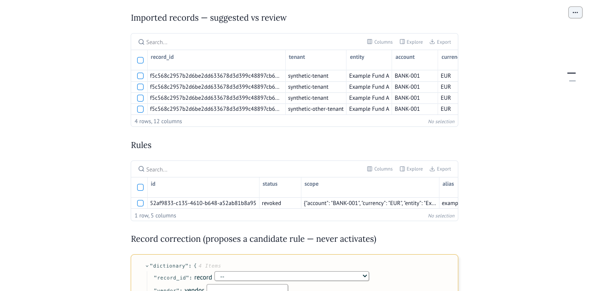
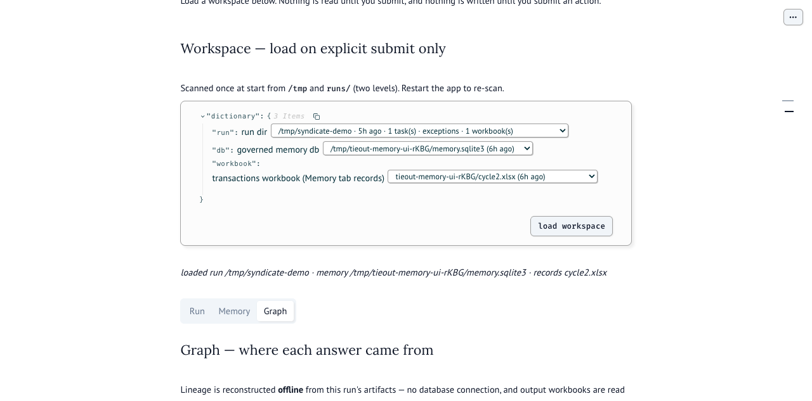
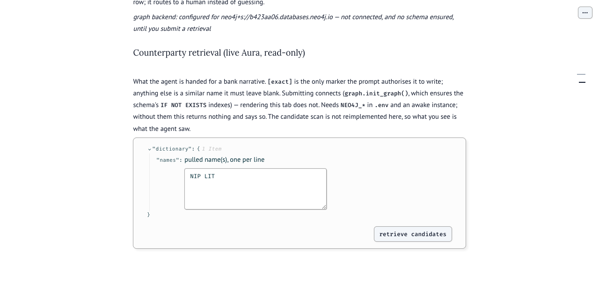

# Documentation hub

Everything below this page is a detail page. Start here, follow the one link you need.

- **Frontends** — the two surfaces people actually open
- **What to read** — one row per question
- **Commands** — the run recipes, in one place

---

## Frontends

Two surfaces, both readable without a key. They read the same artifacts.

### 1. Public site — [udirobert.github.io/tieout](https://udirobert.github.io/tieout/)

Source: [`docs/index.html`](index.html) (static, no build, no credentials, no server).
It carries the workflow, the counted numbers, and the entry film.

**Fig. 01 — the close ledger** lives at [`docs/figures/index.html`](figures/index.html):
an isometric close package where the cells that need a human are the only lit
thing on the plate. Press one to read its source rows; press the write gate and
it refuses until a decision is recorded. Source:
[`fig01-close-ledger.js`](figures/fig01-close-ledger.js), rebuilt with
`python3 scripts/build_figure.py`.

### 2. Tie-out console — [`demo/console.py`](../demo/console.py)

The marimo app over three tabs:

| Tab | What it shows |
|---|---|
| **Run** | Every answer cell graded against golden by `sb.values_equal`, the exception queue, and approve/reject through `exceptions.apply_decisions` |
| **Memory** | Governed rules, and the suggested-vs-review split on imported records |
| **Graph** | Cell lineage — rebuilt offline from the run's artifacts, plus live Aura retrieval on explicit submit |

```bash
uv sync --directory research
uv run --directory research marimo run ../demo/console.py           # Run / Memory / Graph tabs
uv run --directory research marimo run ../demo/close_workspace.py   # legacy: governed memory review
uv run --directory research marimo run ../demo/loop_dashboard.py    # legacy: improvement curve + exception review
```

**Public interactive demo (molab).** `console.py` is self-contained for
[molab](https://molab.marimo.io): mirrored from GitHub, its first cell clones this repo
into the container and seeds synthetic scratch data (a simulated run plus the two-cycle
memory scenario), so each visitor's ephemeral sandbox has a workspace to explore. Writes
only touch that sandbox; no credentials are bundled, so the Graph tab shows offline
lineage and says why retrieval is off.

[](https://molab.marimo.io/github/udirobert/tieout/blob/main/demo/console.py)

The Graph tab needs no database: it replays the run's artifacts through the same
`graph_payload()` a live run used (`rebuild_graph.lineage_from_artifacts`). Live Aura
adds only the candidate retrieval, on explicit submit. The graph remains readable from
the CLI (`harness/graph.py query`) or from Cypher in the Aura console.

Captured once, under explicit permission, against real artifacts on this machine
(verification boundary in [COREWEAVE.md](COREWEAVE.md#verification-status)). The run
pictured is `/tmp/syndicate-demo`, written by `demo/simulate_demo.sh`, so its 15/15
carries the "construction, not model evidence" banner:

| | |
|---|---|
|  | **Run** — every answer cell graded against golden by `sb.values_equal`, with the simulated-run banner |
|  | **Run** — the exception queue; approve/reject go through `exceptions.apply_decisions` |
|  | **Memory** — governed rules and the suggested-vs-review split on imported records |
|  | **Graph** — lineage rebuilt offline from artifacts; blanks explained as routed-to-human |
|  | **Graph** — one live Aura retrieval: candidates ranked, none `[exact]`, so the gate leaves the cell blank |

---

## What to read

### The original submission

| # | Doc | For |
|---|-----|-----|
| 1 | [**SYNDICATE.md**](SYNDICATE.md) | What tieout is, how it works, how we used AO |
| 2 | [**demo.md**](demo.md) | Demo video script + commands (`close-tieout-bank-cp`) |
| 3 | [**submit.md**](submit.md) | Checklist, Devpost copy, AO install + session log |

**Track:** Autonomous Office of the CFO · **Devpost:** https://syndicate-by-maximor.devpost.com/

### The active surface

| Doc | For |
|-----|-----|
| [**close_keeper/README.md**](../close_keeper/README.md) | The Strands agent for the close: the working agreement, the governed write path, the Seapoint MCP connection, and what is verified |
| [**close_keeper/app.py**](../close_keeper/app.py) | The close desk — the customer-facing surface: load, queue, decide, memory, history |
| [**HACKATHONS.md**](HACKATHONS.md) | close-keeper's next entries: which events admit an existing project, and what each needs |

### Deeper docs, each carrying its own measured caveats

| Doc | For |
|-----|-----|
| [**COREWEAVE.md**](COREWEAVE.md) | The self-improvement loop and the governed correction memory — review workflow, what is and is not verified |
| [**NEO4J.md**](NEO4J.md) | Optional knowledge graph: cell lineage + counterparty retrieval, the measured read-path A/B, and the fixture's answer-key leak |

### Elsewhere in the repo

| Doc | For |
|-----|-----|
| [**demo/README.md**](../demo/README.md) | Fixtures, scenarios, and the demo commands |
| [**research/README.md**](../research/README.md) | The research track (SpreadsheetBench) and how to score it |
| [**research/data/eval/qwen3-8b-molab/**](../research/data/eval/qwen3-8b-molab/) | The Qwen3-8B thinking-on/off comparison: write-up, runs, predictions, results |
| [**videos/close-keeper-finops/**](../videos/close-keeper-finops/) | The 2:00 entry film, its frame-by-frame source, and `BRIEF.md` |
| [**harness/README.md**](../harness/README.md) | The agent pipeline and the self-improvement loop's mutation surface |

---

## Commands

### Original reconciliation

```bash
python3 demo/build_fixtures.py
./demo/simulate_demo.sh close-tieout-bank-cp
cd research && uv run python ../harness/exceptions.py review /tmp/syndicate-demo/exceptions.json
```

Live inference (optional): set `TINKER_API_KEY` from `.env`, then
`./demo/run_demo.sh close-tieout-bank-cp`. Env: `TINKER_API_KEY` (required for live),
`GEMINI_API_KEY` (optional spare).

### Governed close-memory demo (two cycles)

```bash
uv sync --directory research
DEMO_DIR=$(mktemp -d /tmp/tieout-memory-demo.XXXXXX)
uv run --directory research python ../demo/memory_scenario.py --out-dir "$DEMO_DIR"
uv run --directory research marimo run ../demo/console.py   # Memory tab; picker finds $DEMO_DIR
```

The script shows a synthetic correction, replay gate, explicit activation, second-cycle
suggestions, and revocation. It ends revoked; `evidence.json` preserves every stage and
`cycle2-reviewed.xlsx` preserves the suggestions exported while active. No API key is
needed. This is a functional demonstration, not a measured customer ROI. Full detail:
[COREWEAVE.md](COREWEAVE.md#run-the-synthetic-two-cycle-demonstration).

### Self-improvement loop (CoreWeave)

Set `WANDB_API_KEY` in `.env` — enables W&B Inference + Weave tracing/evals.

```bash
# pipeline on W&B Inference, traced:
cd research && uv run python ../harness/pipeline.py \
  --dataset-dir ../demo/close-tieout --out-dir /tmp/tieout-wandb \
  --model wandb:meta-llama/Llama-3.3-70B-Instruct

# the loop: eval -> cluster failures -> mutate skills -> re-score -> keep/revert
uv run python loop.py --dataset-dir data/spreadsheetbench_verified_400 \
  --sample 20 --iters 3 --out-dir /tmp/tieout-loop

# console (marimo): Run tab = accuracy curve + exception review; Graph tab = lineage
uv run --directory research marimo run ../demo/console.py
```

Never run concurrent experimental loops — they share `harness/skills_overlay.json`.
See [COREWEAVE.md](COREWEAVE.md#sponsor-tooling-and-research-commands).

### Knowledge graph (Neo4j, optional)

Set `NEO4J_URI`/`NEO4J_USER`/`NEO4J_PASSWORD` in `.env` (Aura). Without creds it no-ops:
identical `exceptions.json`, prompts, and scores.

```bash
# seed the counterparty master, then write lineage offline (no API key)
cd research && uv run --extra graph python ../demo/seed_graph.py
TIEOUT_RUN_ID=demo ./demo/simulate_demo.sh close-tieout-bank-cp

# read candidates back (the GraphRAG retrieval), or run live with the read on
cd research && uv run --extra graph python ../harness/graph.py query "NIP LIT"
TIEOUT_GRAPHRAG=1 ./demo/run_demo.sh close-tieout-bank-cp

# recover the graph from artifacts after an Aura pause/delete
cd research && uv run --extra graph python ../demo/rebuild_graph.py /tmp/syndicate-demo
```

Details, including the measured read-path A/B and the fixture's answer-key leak, in
[NEO4J.md](NEO4J.md).

### close-keeper (local, no keys)

```bash
uv sync --directory research --extra agent
research/.venv/bin/python -m close_keeper --no-seapoint \
  "Tie out the close package (all tasks), then tell me which cells need my decision and why."
```

### The close desk — the customer surface

[`close_keeper/app.py`](../close_keeper/app.py) is the app a finance team would
use, as opposed to the console, which is the instrument an engineer uses. One
flow: load a close package, review the queue with its evidence and diff, decide
through the recorded write path, then read the governed memory and the history
of every decision the tenant has made.

```bash
uv run --directory research marimo run ../close_keeper/app.py
```

### Reviewing a close from the CLI

```bash
# the queue, with the evidence rows and the before → after diff
python3 harness/exceptions.py review /tmp/syndicate-demo/exceptions.json

# record every decision in the tenant's ledger as well
python3 harness/exceptions.py review /tmp/syndicate-demo/exceptions.json \
  --approve-all --ledger /tmp/syndicate-demo/ledger.sqlite3 \
  --reviewer "ann" --tenant "fund-admin-1"

# what that close cost
python3 harness/close_metrics.py /tmp/syndicate-demo/exceptions.json \
  --ledger /tmp/syndicate-demo/ledger.sqlite3 \
  --tenant "fund-admin-1" --period "2026-10" --dataset "demo/close-tieout"
```

---

Code: [`demo/`](../demo/) · [`harness/`](../harness/) · [`research/`](../research/)
